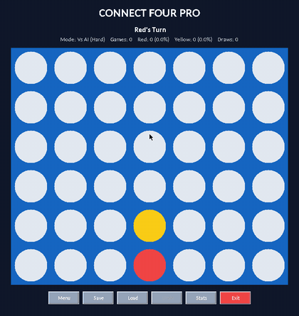
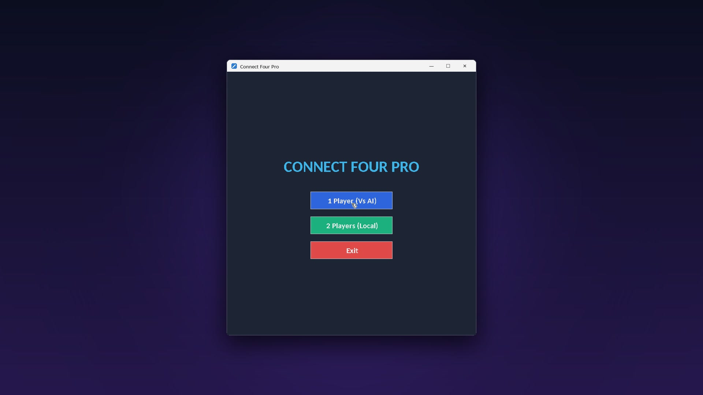
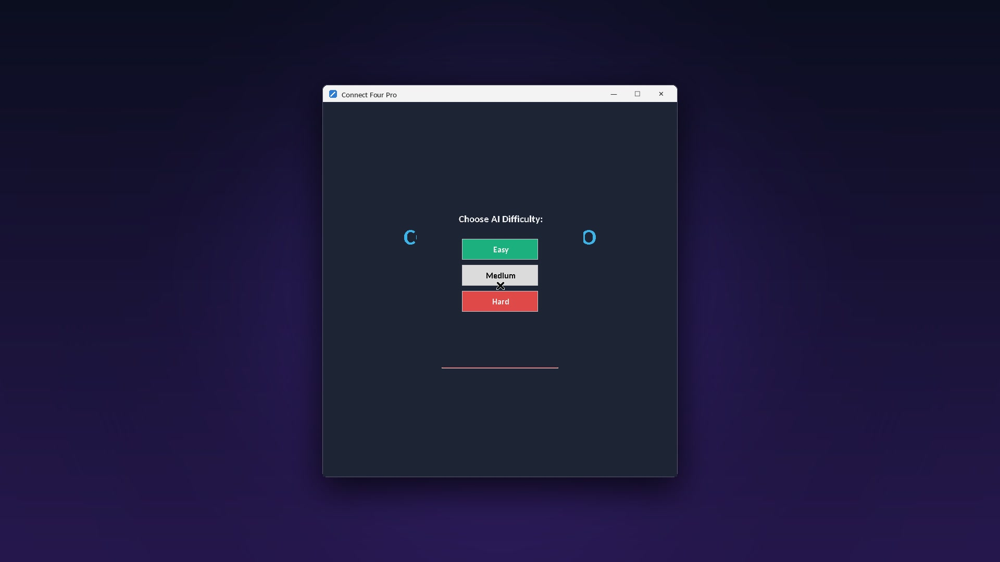
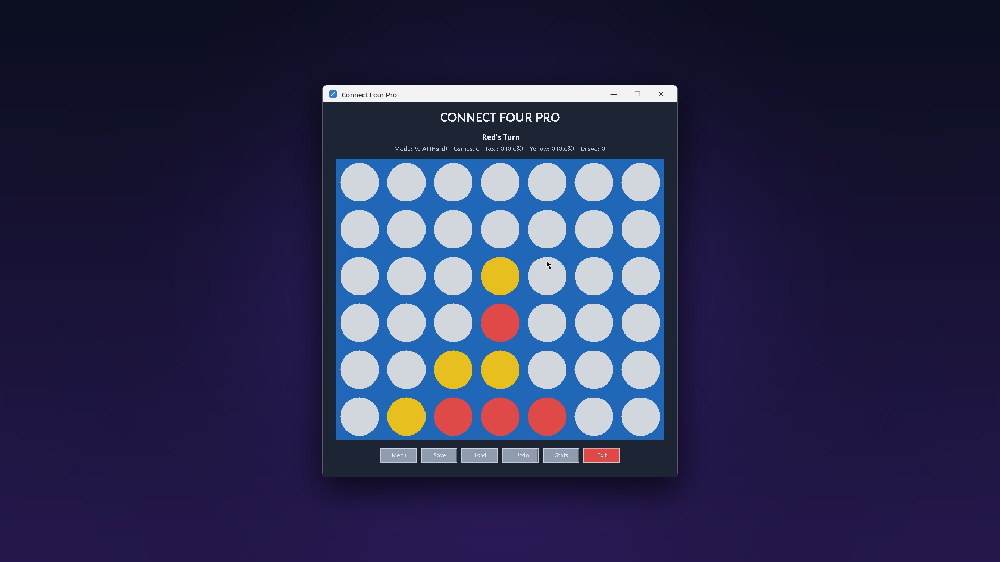
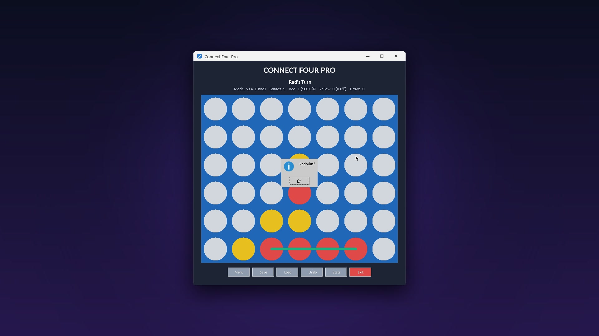

# 🔴🟡 Connect Four Pro

A polished desktop **Connect Four** game built with **Python and Tkinter**. Play a friend on the same computer or challenge a computer opponent with three difficulty levels. It has animated piece drops, a hover preview, save/load, undo and lifetime statistics.


<p align="center">
  
</p>

---

## ✨ Features

- **Two game modes:** 1 Player (vs AI) or 2 Players on the same machine
- **Three AI difficulty levels**
  - **Easy:** mostly random moves, and only occasionally spots a win or a block
  - **Medium:** always takes a winning move, always blocks yours, and prefers the centre column
  - **Hard:** wins and blocks like Medium, and favours the three centre columns to build threats
- **Animated piece drop** into the lowest free row
- **Hover preview:** a dashed outline shows where your piece will land
- **Win highlight:** the four connected pieces are marked with a line
- **Undo** (2-player mode): takes back the last pair of moves
- **Save / Load:** continue a game later (`connect4_save.json`)
- **Lifetime statistics:** games played, Red / Yellow wins and draws, with win percentages (`connect4_stats.json`)
- **Full-column warning** and draw detection

---

## 📸 Screenshots

| Start screen | Choose AI difficulty |
| :---: | :---: |
|  |  |
| **Playing the Hard AI** | **Four in a row!** |
|  |  |

---

## 🚀 Getting Started

**Requirements:** Python 3.8+ (Tkinter ships with the standard Python installer on Windows and macOS).

```bash
# 1. Download or clone this repository, then open the project folder
cd Connect_4_Game

# 2. Run the game
python "Connect Four Game - Source Code.py"
```

> On Linux, install Tkinter first if needed: `sudo apt install python3-tk`

---

## 🎮 How to Play

1. Choose **1 Player (Vs AI)** (then pick Easy, Medium or Hard) or **2 Players (Local)**.
2. Move the mouse over a column to preview your move, then **click** to drop a piece.
3. Connect **four of your colour** horizontally, vertically or diagonally to win.
4. Use the toolbar while playing:

| Button | Action |
| --- | --- |
| 📋 Menu | Return to the start screen |
| 💾 Save | Save the current game |
| 📂 Load | Load the last saved game |
| ↩️ Undo | Undo the last two moves (2-player mode) |
| 🏆 Stats | Show lifetime statistics |
| 🚪 Exit | Close the game |

---

## 🛠️ Tech Stack

- **Python 3**
- **Tkinter:** windows, buttons and the `Canvas` board drawing and animation
- **json:** saved games and statistics
- **random:** AI move variety

---

## 📂 Project Structure

```
Connect Four Game/
├── Connect Four Game - Source Code.py   # the whole game (≈530 lines)
├── connect4_save.json                   # created when you save a game
├── connect4_stats.json                  # created after the first finished game
└── assets/                              # screenshots and preview GIF for this README
```

---

## 🔮 Ideas for Future Improvements

- Minimax / alpha-beta search for a truly unbeatable "Expert" AI
- Sound effects and a winning animation
- Online multiplayer
- Theme / colour customisation

---

## 👤 Author

**Somya Ranjan Sahoo** · [GitHub](https://github.com/somyaranjansahoo6422) · [Portfolio](https://somyaranjansahoo6422.github.io/projects/smaller-builds/)

If you like this project, consider giving it a ⭐!
